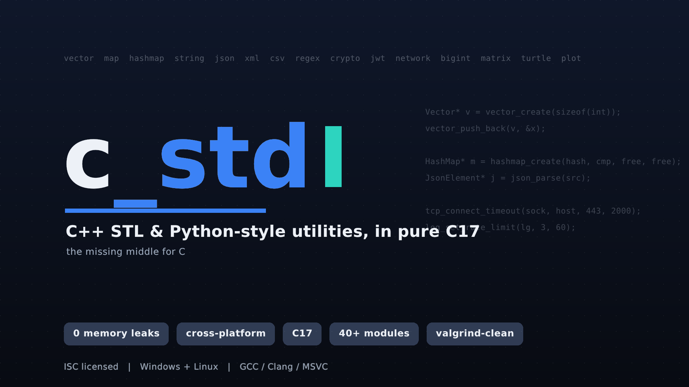
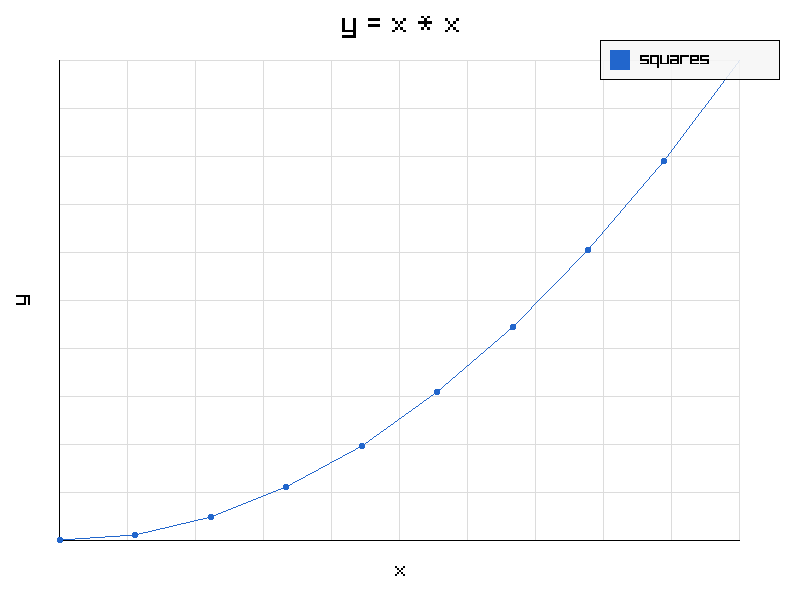

# C STL — C++ Standard Library & Python-style utilities, reimplemented in C

<p align="center">
  
</p>

This project reimplements a large slice of the **C++ Standard Library** (containers,
algorithms, smart pointers, …) together with many **Python-style conveniences**
(`statistics`, `random`, `secrets`, `json`, `regex`, …) in pure **C17**. The goal is
to give C developers familiar, well-documented building blocks — dynamic arrays,
maps, strings, JSON, networking, big integers, and much more — without leaving the C
ecosystem.


## Highlights

- **Leak-checked.** The runnable README examples were run on Linux under Valgrind
  (`--leak-check=full --track-fds=yes`) without leaked memory or descriptors.
  Examples that need a GUI, a PostgreSQL server, serial hardware or the internet
  were not part of that run.

- **Cross-platform.** Builds and runs on **Windows** (MSVC and MinGW-w64) and
  **Linux** (GCC/Clang), with POSIX/Win32 backends behind one API. The library builds
  without warnings under `-Wall -Wextra` (GCC and Clang).

- **C17.** No C++ — C17 with thin platform shims. The default build uses the GNU dialect
  (`-std=gnu17`, for the POSIX/Win32 declarations some modules need); pass
  `-DCMAKE_C_EXTENSIONS=OFF` for `-std=c17`. The `<MODULE>_LOG` debug macros and the
  `unittest` assertion macros are standard C (no `, ##__VA_ARGS__`), so they stay clean
  under `-std=c17 -Wpedantic`.

- **40+ modules.** Containers, algorithms, smart pointers, strings, JSON/XML/CSV/INI,
  networking (TCP/UDP/HTTP), crypto & JWT, arbitrary-precision math, graphics, and more.

- **Familiar APIs.** Modeled on the C++ STL (`vector`, `map`, `unique_ptr`, …) and the
  Python standard library (`random`, `statistics`, `json`, `regex`, `turtle`, …).

- **Runnable examples.** Every module README contains complete example programs
  with the output they print. (The repository does not ship a separate test suite.)

- **Fast & predictable.** Efficient data structures (geometric `vector` growth
  with inlined `push_back`/`at`, typed `vector` macros and a pdqsort generator
  faster than `std::sort`, O(1) average `hashmap`, O(log n) `map`), clear
  ownership rules and deallocators.

- **CMake build.** Build the whole library, a single module, or your own example programs,
  with GCC, Clang, or MSVC.

## Benchmarks vs the C++ STL

The library aims to be *fast where it counts*. The table below pits each C
container against its C++ `<stl>` counterpart on the **same workload, the same
data, and the same compiler family** at `-O2`. Both programs walk an identical
deterministic key stream and compute identical checksums, so they do exactly the
same work — only the container implementation differs.

Environment: Windows 10, MinGW-w64 **GCC / G++ 14.2.0**, `-O2`, single thread,
best of three runs (lower is better). Absolute numbers vary by machine; the
**ratio** is what carries over.

| C container ↔ C++ STL | Workload (N) | C&nbsp;STL | C++&nbsp;STL | C ÷ C++ |
| --- | --- | --: | --: | :--: |
| `vector` ↔ `std::vector<int>` | `push_back` + sum, 10,000,000 | 0.040 s | 0.030 s | 1.3× |
| `vector` typed macros ↔ `std::vector<int>` | `VECTOR_PUSH_BACK` + `VECTOR_FOREACH`, 10,000,000 | 0.037 s | 0.030 s | 1.2× |
| `vector` ↔ `std::vector<int>` | fill 10,000,000 computed values (`VECTOR_APPEND_UNINIT` ↔ `resize` + `[]`) | **0.0099 s** | 0.0122 s | **0.82×** |
| `VECTOR_DEFINE_SORT` ↔ `std::sort` | sort 5,000,000 random `int`s | **0.157 s** | 0.317 s | **0.50×** |
| `algorithm_sort` (stable) ↔ `std::stable_sort` | sort 5,000,000 random `int`s (comparator through a pointer) | 0.451 s | 0.383 s | 1.18× |
| `algorithm_sort_unstable` ↔ `std::sort` | sort 5,000,000 random `int`s (comparator through a pointer) | **0.280 s** | 0.313 s | **0.89×** |
| `algorithm_filter` ↔ `std::copy_if` | keep the odd ones of 5,000,000 random `int`s | **0.0099 s** | 0.0171 s | **0.58×** |
| `string` ↔ `std::string` | `find` in 4 MiB of text, ×20 | **0.0055 s** | 0.0276 s | **0.20×** |
| `string` ↔ `std::string` | `push_back` ×20,000,000 / `append` "abc" ×10,000,000 | 0.034 / 0.034 s | 0.035 / 0.033 s | 0.97× / 1.02× |
| `string` ↔ `std::string` | `substr` / `trim` ×2,000,000 / ×1,000,000 | **0.092 / 0.054 s** | 0.182 / 0.095 s | **0.51× / 0.57×** |
| `map` ↔ `std::map<int,int>` (ordered / RB-tree) | insert + lookup, 1,000,000 | **1.00 s** | 1.20 s | **0.83×** |
| `hashmap` ↔ `std::unordered_map<int,int>` | insert + lookup, 1,000,000 | **0.231 s** | 0.364 s | **0.63×** |
| `set` ↔ `std::set<int>` (ordered / RB-tree) | insert + lookup, 1,000,000 | 1.17 s | 1.05 s | 1.1× |
| `priority_queue` ↔ `std::priority_queue<int>` | push + pop (heap-sort), 1,000,000 | 0.156 s | 0.108 s | 1.4× |
| `deque` ↔ `std::deque<int>` | `push_back` + iterate + `pop_front`, 1,000,000 | 0.009 s | 0.004 s | 2.2× |
| `list` ↔ `std::list<int>` | `push_back` + iterate + teardown, 1,000,000 | 0.093 s | 0.075 s | 1.2× |
| `forward_list` ↔ `std::forward_list<int>` | `push_front` + iterate + teardown, 1,000,000 | 0.080 s | 0.076 s | 1.05× |
| `queue` ↔ `std::queue<int>` | enqueue + dequeue (FIFO), 1,000,000 | 0.006 s | 0.003 s | 2.0× |
| `stack` ↔ `std::stack<int>` | push + pop (LIFO), 1,000,000 | 0.005 s | 0.003 s | 1.7× |

`C ÷ C++` is the C time divided by the C++ time — **below 1.0 means the C
library is faster.**

- **Where C wins — `map`, `hashmap`, bulk `vector` work and sorting.** Both allocate their tree nodes /
  buckets from a pooled slab allocator, so a million inserts cost a handful of
  big `malloc`s instead of a million tiny ones, beating the STL's per-node `new`.
  The `vector` fills in place without `std::vector`'s zero-fill pass
  (`VECTOR_APPEND_UNINIT`; zero-initialised growth comes straight from `calloc`),
  and `VECTOR_DEFINE_SORT` generates a pattern-defeating quicksort (pdqsort) for
  the element type that is about 2× faster than libstdc++'s `std::sort` on random
  data. The full comparison — every common operation, generic API and typed
  macros — is in [`vector/README.md`](vector/README.md#performance-compared-with-stdvector).
  `algorithm_sort_unstable` is a pdqsort too and beats `std::sort` even though
  it calls its comparator through a function pointer (`algorithm_sort` itself
  is stable: equal elements keep their order); `algorithm_filter` / `copy_if`
  collect the predicate's answers in a bit mask before copying, so a random
  predicate costs no branch mispredictions. Function-by-function numbers are in
  [`algorithm/README.md`](algorithm/README.md#performance-compared-with-c-algorithm).
  `String` keeps up to 31 bytes inside the struct (small-string optimisation),
  inlines its hot paths like `std::string` does, and searches with SSE2 (5–10×
  faster `find`); creating many short heap Strings is the one place it trails,
  by the size of its 64-byte struct — see
  [`string/README.md`](string/README.md#performance-compared-with-stdstring).
- **About `set` — near parity.** Same pooled-slab, inline-element RB-tree as
  `map`. Lookups are actually a hair *faster* than `std::set`; inserts are a
  little slower, so it nets ~1.1×. Unlike `map` (which stores caller-owned
  pointers and skips the copy), `set` has value semantics and deep-copies each
  element exactly like `std::set`, so it can't win the copy back — and its node
  carries the publicly-inspectable `key`/`left`/`right`/`parent`/`color` fields
  (so a test can walk them to check the red-black invariants), which a templated
  `std::set` node doesn't expose. A large RB-tree is cache-miss-bound, so that
  slightly larger node is the whole gap.
- **Where C++ wins — per-element `vector` pushes and `priority_queue`.** Both are
  tight loops over raw `int`s. The C `vector` inlines `push_back`/`at` at the call
  site just like `std::vector` (reads, copies, appends, insert / erase and pop are
  at parity), but a growing loop of single pushes stays ~1.3× with the generic
  API: a runtime `itemSize` stride and a size-dispatched element copy where C++
  has a compile-time `sizeof(int)`, plus the bounds check in `vector_at` that
  `operator[]` skips. The typed macros (`VECTOR_PUSH_BACK`, `VECTOR_FOREACH`)
  remove the type erasure and land at ~1.1–1.2×; what is left is that the
  `Vector` is a heap object with public fields, so each push stores its size back
  to memory where `std::vector` keeps its pointers in registers. The C `priority_queue` size-dispatches its heap moves
  the same way (~1.4×); its residual is the **comparator** — one indirect call
  through a function pointer per comparison, which `std::priority_queue` inlines
  from its template argument. Either way it's a small fixed per-element cost — the
  price of a uniform C API — not a worse complexity.
- **About `deque`.** The C `deque` stores elements *inline* in byte-budgeted
  block buffers (one allocation per block, not one `malloc` per element) and
  inlines `front` / `back` / `at` with shift-indexed block math like
  `std::deque`, so it lands at ~2.2×; the residual is the out-of-line
  `push_back` / `pop_front` calls that `std::deque` inlines from templates.
- **About `list`.** Each node stores its element *inline* in the same allocation
  (one `malloc` per node, like `std::list`) instead of a second heap block per
  element, which roughly halves the allocation/teardown cost and lands it at
  ~1.2×. The residual is a slightly larger node — the type-erased API keeps a
  `value` pointer and aligns the inline element for any type — plus the
  out-of-line per-node call `std::list` inlines.
- **About `forward_list` — at parity.** It already uses the same single-node-
  allocation, inline-element design as `std::forward_list`, so `push_front` /
  iterate / teardown match it within measurement noise (≈1.05×). No type-erasure
  penalty survives here because the per-node `malloc` dominates and both pay it
  once per element.
- **About `queue`.** The C `queue` is a contiguous `vector` used as a ring:
  `enqueue` appends and `dequeue` advances a front index (an O(1) bump, not a
  buffer shift), with the dead front prefix reclaimed in bulk when the buffer
  fills — so both ends are amortized O(1), like `std::queue`. The hot ops are
  inlined; the ~2× residual is the per-element copy into the contiguous buffer
  vs `std::queue`'s `deque` node writes. (Previously `dequeue` shifted the whole
  buffer — **O(n)**, an O(n²) drain; that's fixed.)
- **About `stack`.** LIFO at the back of a contiguous `vector`, so push and pop
  are already O(1). `push` / `top` / `pop` / `empty` are now inlined in the header
  (the way `std::stack` inlines through its container), which cut it from ~3.3× to
  ~1.7×; the residual is the `vector`'s amortized realloc-copy on growth vs
  `std::stack`'s default `deque` adding blocks — in exchange the C stack keeps its
  elements fully contiguous.

The benchmark programs themselves (`bench.c` / `bench.cpp`) are not part of the
repository, so treat the table as indicative. To measure on your machine, write a C
and a C++ program that run the workloads above over the same key stream, and link
the C one against the built library, which contains every container:

```bash
cmake -S . -B build && cmake --build build
gcc -O2 bench.c -I. build/libcstd.a -o bench_c && ./bench_c
g++ -O2 -std=c++17 bench.cpp -o bench_cpp && ./bench_cpp
```

## A personal note

I undertake this project out of a deep affection for the C programming language. C
remains an essential tool for any computer engineer, providing the foundation needed
to build efficient and robust software. This effort aims to enrich the language with
the conveniences found in higher-level standard libraries.

---

## Table of contents

- [Highlights](#highlights)
- [Benchmarks vs the C++ STL](#benchmarks-vs-the-c-stl)
- [Modules](#modules)
- [Dependencies](#dependencies)
- [Installing the dependencies](#installing-the-dependencies)
  - [Windows (MSYS2 / MinGW-w64)](#windows-msys2--mingw-w64)
  - [Debian / Ubuntu](#debian--ubuntu)
  - [Fedora](#fedora)
- [Building with CMake](#building-with-cmake)
  - [Build everything](#build-everything)
  - [Build / run one piece at a time](#build--run-one-piece-at-a-time)
  - [Choosing a compiler (GCC / Clang / MSVC)](#choosing-a-compiler-gcc--clang--msvc)
  - [Build options](#build-options)
- [Examples](#examples)
- [Per-module documentation](#per-module-documentation)
- [Contributing](#contributing)
- [License](#license)

---

## Modules

Every module lives in its own directory with a `.c` source, a `.h` header, and a
`README.md` containing a full API reference and runnable examples.

### Containers
| Module | Analogous to | Description |
|--------|--------------|-------------|
| `array` | `std::array` | Fixed-size array wrapper with bounds-checked access. |
| `vector` | `std::vector` | Dynamic, automatically resizing array (one contiguous buffer, grown geometrically). |
| `string` | `std::string` | Growable, binary-safe string with small-string optimisation, SSE2 search and a rich (Python-style) manipulation API (`string/std_string.h`). |
| `list` | `std::list` | Doubly linked list. |
| `forward_list` | `std::forward_list` | Singly linked list. |
| `deque` | `std::deque` | Double-ended queue with fast insertion/removal at both ends. |
| `queue` | `std::queue` | FIFO queue. |
| `stack` | `std::stack` | LIFO stack. |
| `priority_queue` | `std::priority_queue` | Heap-backed priority queue with a custom comparator. |
| `span` | `std::span` | Non-owning view over a contiguous sequence. |
| `bitset` | `std::bitset` | Fixed-size sequence of bits with bitwise operations. |
| `map` | `std::map` | Ordered associative container (Red-Black tree, O(log n)). |
| `hashmap` | `std::unordered_map` | Hash table with O(1) average insert/lookup and automatic rehashing. |
| `set` | `std::set` | Ordered, unique associative container (Red-Black tree, O(log n)); |
| `tuple` | `std::tuple` | Fixed-size heterogeneous collection. |
| `variant` | `std::variant` | Type-safe tagged union with a visitor interface. |
| `uniqueptr` | `std::unique_ptr` | RAII smart pointer with automatic, scope-based cleanup. |

### Algorithms & numerics
| Module | Description |
|--------|-------------|
| `algorithm` | Generic algorithms inspired by `<algorithm>`: stable sort, pdqsort, search, transform, accumulate, … plus Python's `filter` and `itertools.combinations`. |
| `sort` | Stand-alone sorting library: 8+ algorithms, benchmarking and search helpers. |
| `statistics` | Mean, median, variance, … (mirrors Python's `statistics`). |
| `random` | Pseudo-random numbers and sequence helpers (mirrors Python's `random`). |
| `secrets` | Cryptographically secure random numbers/tokens and constant-time comparison. |
| `uuid` | RFC 9562 Universally Unique Identifiers (v4/v7/v3/v5, Nil/Max), mirroring Python's `uuid`. |
| `numbers` | Mathematical constants (header-only, like C++20 `<numbers>`). |
| `matrix` | Matrix creation, manipulation and linear-algebra operations. |
| `bigint` | Arbitrary-precision integers (backed by **GMP**). |
| `bigfloat` | Arbitrary-precision floating point (backed by **MPFR**). |
| `evalexpr` | Runtime arithmetic-expression evaluator. |

### Text, data & I/O
| Module | Description |
|--------|-------------|
| `fmt` | Formatting / I/O library inspired by Go's `fmt`, with Unicode support. |
| `encoding` | Base64 / Base32 / Base16 / URL encoding and decoding. |
| `json` | Parse, generate and manipulate JSON. |
| `xml` | Parse, create, modify and traverse XML documents. |
| `csv` | Read, write and manipulate CSV files. |
| `config` | Read/modify/save INI-style configuration files. |
| `regex` | Regular-expression compile/match/search (PCRE when it is installed — required on Windows; otherwise POSIX `<regex.h>`). |
| `cli` | Command-line argument/option/sub-command parser. |
| `log` | Leveled logging (DEBUG…FATAL) to console and/or file. |
| `file_io` | `FileReader` / `FileWriter` with text and binary (UTF-8/UTF-16) modes. |
| `dir` | Directory and filesystem manipulation. |

### Time & date
| Module | Description |
|--------|-------------|
| `time` | Time measurement and manipulation (`time/std_time.h`). |
| `date` | Gregorian and Persian calendar dates, conversions and arithmetic. |

### System & concurrency
| Module | Description |
|--------|-------------|
| `sysinfo` | OS / hardware information (Windows & Linux). |
| `concurrent` | Threads, mutexes, condition variables, semaphore and a thread pool. |
| `serial_port` | Serial-port (RS-232) communication. |

### Security
| Module | Description |
|--------|-------------|
| `crypto` | Hashing, encryption/decryption and other primitives (backed by **OpenSSL**). |
| `jwt` | JSON Web Token creation/verification (HS/RS/ES/PS families). |

### Networking & databases
| Module | Description |
|--------|-------------|
| `network` | TCP and UDP sockets plus a small HTTP server/client. |
| `database` | PostgreSQL client built on **libpq** (optional — only built when libpq is present). |

### Graphics
| Module | Description |
|--------|-------------|
| `plot` | 2-D plotting (line/scatter/bar) built on **raylib**. |
| `turtle` | Turtle graphics, inspired by Python's `turtle` (built on **raylib**). |

### Testing
| Module | Description |
|--------|-------------|
| `unittest` | Lightweight unit-testing framework (assertions, suites, fixtures). |

---

## Dependencies

To build the whole project you need:

**Build tools**
- **CMake** ≥ 3.15
- A **C17** compiler — GCC, Clang, or MSVC
- A generator — **Ninja** (recommended) or Make / Visual Studio

**Third-party libraries** (installed system-wide via your package manager)

| Library | Used by | Required? |
|---------|---------|-----------|
| **OpenSSL** (`libssl`, `libcrypto`) | `crypto`, `jwt`, `network` (and `config`, `dir`, which use `crypto`) | Optional — those modules are skipped (with a warning) when it is missing |
| **raylib** | `plot`, `turtle` | Optional — those two modules are skipped when it is missing |
| **GMP** | `bigint`, `bigfloat` | Optional — skipped when missing |
| **MPFR** | `bigfloat` | Optional — skipped when missing |
| **PCRE** (PCRE1, `libpcre`) | `regex` | Required on Windows (there is no POSIX `<regex.h>`); optional elsewhere — without it `regex` uses POSIX regex |
| **PostgreSQL / libpq** | `database` | Optional — the `database` module is skipped automatically if libpq is missing |
| **pthreads** | `concurrent`, `network` | Provided by the toolchain (winpthread on Windows) |

> The project no longer uses the old `compile.py` script — the build is **CMake-only**.

---

## Installing the dependencies

### Windows (MSYS2 / MinGW-w64)

Install [MSYS2](https://www.msys2.org/) (this project assumes it lives at `C:\msys64`).
Open the **“MSYS2 MinGW x64”** shell and run:

```bash
pacman -Syu          # update once (re-open the shell if it asks you to)

pacman -S --needed \
  mingw-w64-x86_64-toolchain \
  mingw-w64-x86_64-clang \
  mingw-w64-x86_64-cmake \
  mingw-w64-x86_64-ninja \
  mingw-w64-x86_64-openssl \
  mingw-w64-x86_64-raylib \
  mingw-w64-x86_64-gmp \
  mingw-w64-x86_64-mpfr \
  mingw-w64-x86_64-pcre \
  mingw-w64-x86_64-postgresql
```

Always build from the **MinGW x64** shell (not the plain *MSYS* shell) so that
`C:\msys64\mingw64\bin` is on the `PATH` and CMake picks up the right compiler and
libraries.

### Debian / Ubuntu

```bash
sudo apt update
sudo apt install \
  build-essential clang cmake ninja-build pkg-config \
  libssl-dev libgmp-dev libmpfr-dev libpq-dev libraylib-dev
```

> `libraylib-dev` is available on Debian 12+ / Ubuntu 22.04+. On older releases,
> install raylib from source (<https://github.com/raysan5/raylib>) or omit the
> `plot`/`turtle` modules.
>
> PCRE is optional on Linux. Where the distribution still ships PCRE1, install its
> development package (`libpcre3-dev`) to get the PCRE backend for `regex`;
> otherwise the POSIX regex in libc is used.

### Fedora

```bash
sudo dnf install \
  gcc clang cmake ninja-build pkgconf-pkg-config \
  openssl-devel gmp-devel mpfr-devel libpq-devel raylib-devel
```

---

## Building with CMake

All commands are run from the project root (`c_std/`).

### Build everything

```bash
# Configure (Ninja generator recommended). Omit -G for the platform default.
cmake -S . -B build -G Ninja

# Build the library, the main demo
cmake --build build

# Build and run the main demo (runs from the project root so ./sources is reachable)
cmake --build build --target run
```

Binaries are written to `build/bin/`.

### Build / run one piece at a time

The project is fully modular — you can compile a single module (or one of your
`examples/<name>.c` programs) without building the rest:

```bash
# Compile just one module's objects
cmake --build build --target vector

# Compile every module library (no executables)
cmake --build build --target modules

```

To use the library from your own CMake project, add the c_std root and link the
`cstd` target: it carries its include path and every library it needs (OpenSSL,
raylib, GMP/MPFR, libpq, threads, the Windows system libraries), so nothing else has
to be listed. `cmake --install build --prefix <dir>` installs `libcstd` and the
headers (under `include/c_std/<module>/`).

```cmake
add_subdirectory(path/to/c_std c_std)
target_link_libraries(your_app PRIVATE cstd)
```

Each module directory also has its own `CMakeLists.txt`: a standalone build of
that module plus the c_std modules it includes (target `c_std_<module>`, e.g.
`c_std_json` also compiles `fmt`, `map`, `string`, `vector`, ...), with only the
third-party libraries that module needs. The top-level build does not use these
files.

```cmake
add_subdirectory(path/to/c_std/json c_std_json)
target_link_libraries(your_app PRIVATE c_std_json)
```

### Choosing a compiler (GCC / Clang / MSVC)

The build is compiler-agnostic and targets the **C17** standard.

```bash
# GCC (default on MSYS2 / Linux)
cmake -S . -B build -G Ninja -DCMAKE_C_COMPILER=gcc

# Clang
cmake -S . -B build -G Ninja -DCMAKE_C_COMPILER=clang
# On MSYS2, use the clang of the environment your libraries come from: in the
# "MSYS2 MinGW x64" shell that is mingw-w64-x86_64-clang (installed above), which
# shares the mingw64 libraries and C runtime with GCC. Do not point the CLANG64
# clang at C:/msys64/mingw64/lib with -L: the result mixes the UCRT startup code
# of clang64 with the msvcrt libraries of mingw64. To build in the CLANG64
# environment instead, install the mingw-w64-clang-x86_64-* versions of the
# packages from the "MSYS2 Clang x64" shell.

# MSVC — from an “x64 Native Tools Command Prompt for VS”
cmake -S . -B build -G "Ninja"            # or: -G "Visual Studio 17 2022"
cmake --build build --config Release
```

On MSVC, install the third-party libraries with [vcpkg](https://vcpkg.io)
(`vcpkg install openssl raylib gmp mpfr libpq pcre`) and pass
`-DCMAKE_TOOLCHAIN_FILE=<vcpkg>/scripts/buildsystems/vcpkg.cmake` when configuring.
Every library source compiles with `cl` (VS 2022, `/std:c17`). Two MSVC
differences to know about: `UPTR_AUTO` is a no-op there (MSVC has no cleanup
attribute, so call `uptr_destroy` yourself), and — on every Windows compiler —
the library's UUID type is `Uuid`: `UUID` is only an alias for it, which
steps aside when `<windows.h>` (directly or through the socket headers) already
defines Windows' own `UUID` (see `uuid/README.md`).

### Build options

| Option | Default | Effect |
|--------|---------|--------|
| `C_STD_BUILD_MAIN` | `ON` | Build the `main` demo executable. |
| `C_STD_BUILD_EXAMPLES` | `ON` | Build every `examples/<name>.c` you put there into an executable `<name>`. |
| `CMAKE_C_EXTENSIONS` | `ON` | `OFF` compiles with `-std=c17` instead of `-std=gnu17`. |


---

## Examples

Every module's `README.md` contains complete example programs. The repository does
not ship an `examples/` directory (it is listed in `.gitignore`), but CMake builds
whatever you put there: save an example as `examples/<name>.c` and run
`cmake --build build --target <name>` (or `--target examples` for all of them).

A few examples are **compile-only** because they need external resources at run time:
`network` (sockets), `database` (a running PostgreSQL server), `serial_port`
(hardware), and `plot` / `turtle` (open a graphical window).

---

## Quick examples

A taste of a few modules. Each snippet is a complete program; the per-module
`README.md` files have many more (with expected output).

### vector — a growable typed array

```c
#include "vector/vector.h"
#include "fmt/fmt.h"

int main(void) {
    Vector* v = vector_create(sizeof(int));
    for (int i = 1; i <= 5; ++i) {
        vector_push_back(v, &i);
    }

    int sum = 0;
    for (size_t i = 0; i < vector_size(v); ++i) {
        sum += *(int*)vector_at(v, i);
    }

    fmt_printf("size=%zu sum=%d\n", vector_size(v), sum);
    vector_deallocate(v);
    return 0;
}
```
```
size=5 sum=15
```

### json — parse and pretty-print

```c
#include "json/json.h"
#include "fmt/fmt.h"

int main(void) {
    JsonElement* root = json_parse("{\"lib\": \"c_std\", \"version\": 1.0, \"tags\": [\"c\", \"stl\"]}");

    json_print(root);
    json_deallocate(root);

    return 0;
}
```
```
{
  "lib": "c_std",
  "tags": [
    "c",
    "stl"
  ],
  "version": 1
}
```

### csv — build a row and export

```c
#include "csv/csv.h"
#include "fmt/fmt.h"
#include <stdlib.h>

int main(void) {
    CsvFile* csv = csv_file_create(',');
    CsvRow*  row = csv_row_create();

    csv_row_append_cell(row, "Alice");
    csv_row_append_cell(row, "30");
    csv_file_append_row(csv, row);

    char* out = csv_file_export_to_string(csv);
    fmt_printf("%s", out);

    free(out);
    csv_file_destroy(csv);
    return 0;
}
```
```
Alice,30
```

### config — load an INI file and read values

```c
#include "config/config.h"
#include "fmt/fmt.h"
#include <stdio.h>

int main(void) {
    /* write a small INI file, then load and read it */
    FILE* f = fopen("app.ini", "w");
    fputs("[server]\nhost = localhost\nport = 8080\n", f);
    fclose(f);

    ConfigFile* cfg = config_create("app.ini");
    fmt_printf("host=%s port=%d\n",
               config_get_value(cfg, "server", "host"),
               config_get_int(cfg, "server", "port", 0));

    config_deallocate(cfg);
    remove("app.ini");

    return 0;
}
```
```
host=localhost port=8080
```

### random — deterministic with a fixed seed

```c
#include "random/random.h"
#include "fmt/fmt.h"

int main(void) {
    random_seed(2024);
    /* one call per statement: the order in which a function's arguments are
       evaluated is unspecified, so three calls inside one printf could print
       in a different order with another compiler */
    int a = random_randint(1, 6);
    int b = random_randint(1, 6);
    int c = random_randint(1, 6);
    fmt_printf("dice rolls: %d %d %d\n", a, b, c);
    
    return 0;
}
```
```
dice rolls: 2 6 3
```

### crypto — SHA-256 of a string

```c
#include "crypto/crypto.h"
#include "fmt/fmt.h"
#include <stdlib.h>

int main(void) {
    size_t   n;
    uint8_t* h   = crypto_hash_string("hello", CRYPTO_SHA256, &n);
    char*    hex = crypto_hash_to_hex(h, n);

    fmt_printf("sha256(\"hello\") = %s\n", hex);

    free(hex);
    free(h);

    return 0;
}
```
```
sha256("hello") = 2cf24dba5fb0a30e26e83b2ac5b9e29e1b161e5c1fa7425e73043362938b9824
```

### concurrent — spawn a thread and join it

```c
#include "concurrent/concurrent.h"
#include "fmt/fmt.h"

static int worker(void* arg) { *(int*)arg += 41; return 0; }

int main(void) {
    int value = 1;
    Thread t;

    thread_create(&t, worker, &value);
    thread_join(t, NULL);
    fmt_printf("value=%d\n", value);

    return 0;
}
```
```
value=42
```

### thread_pool — run 100 tasks on 4 workers

```c
#include "concurrent/thread_pool.h"
#include "concurrent/concurrent.h"
#include "fmt/fmt.h"

static Mutex m;
static int counter = 0;

static int task(void* arg) { 
    (void)arg; 

    mutex_lock(&m); 
    counter++; 
    mutex_unlock(&m); 

    return 0; 
}

int main(void) {
    mutex_init(&m, MUTEX_PLAIN);
    ThreadPool* pool = thread_pool_create(4);


    for (int i = 0; i < 100; ++i) {
        thread_pool_add_task(pool, task, NULL);
    }
    thread_pool_wait(pool);
    fmt_printf("ran %d tasks\n", counter);

    thread_pool_destroy(pool);
    mutex_destroy(&m);

    return 0;
}
```
```
ran 100 tasks
```

### udp — open a socket and bind to an ephemeral port

```c
#include "network/udp.h"
#include "fmt/fmt.h"

int main(void) {
    udp_init();
    UdpSocket sock;

    udp_socket_create(&sock);
    udp_bind(sock, NULL, 0);                 /* any address, kernel-chosen port */

    char host[INET6_ADDRSTRLEN];
    unsigned short port = 0;

    udp_get_local_address(sock, host, sizeof(host), &port);
    fmt_printf("udp socket bound to an ephemeral port: %s\n", port != 0 ? "yes" : "no");

    udp_close(sock);
    udp_cleanup();

    return 0;
}
```
```
udp socket bound to an ephemeral port: yes
```

### tcp — create a listening server socket

```c
#include "network/tcp.h"
#include "fmt/fmt.h"

int main(void) {
    tcp_init();
    TcpSocket server;

    tcp_socket_create(&server);
    tcp_set_reuse_addr(server, true);
    tcp_bind(server, "127.0.0.1", 0);        /* ephemeral port */
    tcp_listen(server, 1);

    char host[INET6_ADDRSTRLEN];
    unsigned short port = 0;

    tcp_get_sock_name(server, host, sizeof(host), &port);
    fmt_printf("tcp server on %s, port assigned: %s\n", host, port != 0 ? "yes" : "no");

    tcp_close(server);
    tcp_cleanup();

    return 0;
}
```
```
tcp server on 127.0.0.1, port assigned: yes
```

### http — build and serialize a response (no network)

```c
#include "network/http.h"
#include "fmt/fmt.h"
#include <stdlib.h>

int main(void) {
    HttpResponse res = {0};

    http_set_status(&res, 200, "OK");
    http_set_body(&res, "Hello, world!");

    char* raw = http_serialize_response(&res);
    fmt_printf("%s", raw);

    free(raw);
    http_free_response(&res);

    return 0;
}
```
```
HTTP/1.1 200 OK
Content-Type: text/plain
Content-Length: 13

Hello, world!
```

### plot — render a line chart to a PNG

```c
#include "plot/plot.h"

int main(void) {
    Plot* p = plot_create("y = x * x", "x", "y");

    float ys[10];
    for (int i = 0; i < 10; ++i) ys[i] = (float)(i * i);

    PlotColor blue = {34, 102, 204, 255};
    plot_add_line(p, ys, 10, "squares", blue);

    plot_export_image(p, "plot_example.png");   /* writes a PNG to disk */
    plot_destroy(p);
    
    return 0;
}
```



### turtle — turtle graphics, saved as a PNG

`turtle` is built on raylib; here we draw four nested squares and save the
canvas with the built-in `turtle_save_image` (a wrapper over raylib's
`TakeScreenshot`, so you don't need to include `raylib.h`). Turtle coordinates
are screen pixels (origin top-left).

```c
#include "turtle/turtle.h"

int main(void) {
    Turtle* t = turtle_create();

    turtle_init_window(420, 420, "c_std turtle");
    turtle_set_fps(60);
    turtle_set_speed(t, 100);                    /* fast (0 would never finish) */
    turtle_set_background_color(t, 255, 255, 255, 255);
    turtle_pen_size(t, 4);

    unsigned char colors[4][3] = {{220,50,50}, {40,160,60}, {40,90,210}, {200,140,30}};
    for (int s = 0; s < 4; ++s) {
        float side = 80.0f + s * 60.0f;

        turtle_pen_up(t);
        turtle_set_position(t, 210.0f - side / 2.0f, 210.0f + side / 2.0f);  /* center it */
        turtle_set_heading(t, 0);
        turtle_pen_down(t);
        turtle_set_pen_color_rgb(t, colors[s][0], colors[s][1], colors[s][2], 255);

        for (int i = 0; i < 4; ++i) {            /* one square */
            turtle_forward(t, side);
            turtle_right(t, 90);
        }
    }
    turtle_draw(t);

    turtle_save_image("turtle_example.png");     /* built-in screenshot helper */
    turtle_deallocate(t);
    turtle_close_window();

    return 0;
}
```


---

## Per-module documentation

Each module ships its own `README.md` with a complete API reference, function
descriptions, and runnable examples that include their expected output. Start with
the module directory you are interested in — e.g. [`vector/README.md`](vector/README.md),
[`json/README.md`](json/README.md), or [`algorithm/README.md`](algorithm/README.md).

---

## Contributing

Contributions are welcome — extending libraries, improving performance, or fixing
bugs. Fork the repository, make your changes, and submit a pull request. New modules
just need their directory added to the `C_STD_MODULES` list in `CMakeLists.txt` (and a
standalone `CMakeLists.txt` in the directory, like the other modules have).

## License

This project is open-source and available under the [ISC License](LICENSE).
